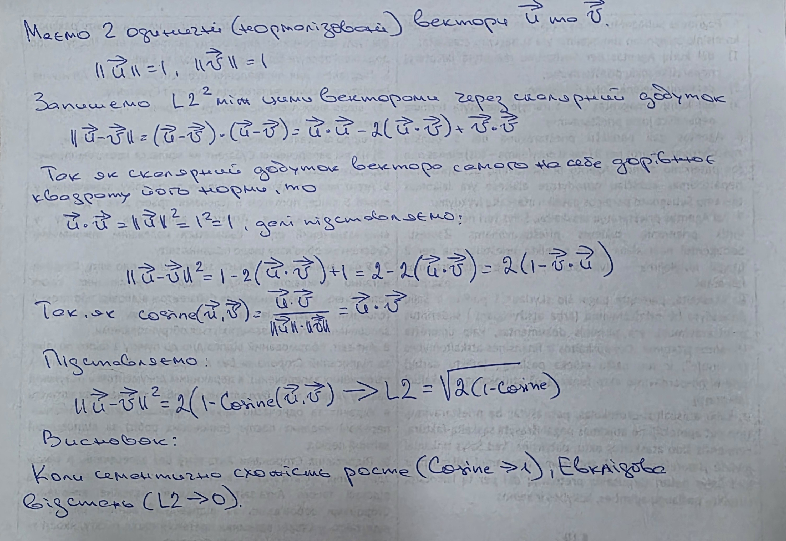

Завдання 2. Семантичний пошук за науковими статтями

Цей проєкт присвячений побудові системи повнотекстового, семантичного та гібридного пошуку по корпусу наукових статей архіва **ArXiv** за допомогою векторної бази даних **Pinecone**, локального індексу **BM25** та моделі ембеддінгів **SPECTER 2**.

---

## Структура проєкту

*   `.env` — змінні оточення (секретний API-ключ Pinecone та шлях до кэшу; доданий у `.gitignore`).
*   `.env.example` — шаблон змінних оточення для інших розробників команди (без реальних ключів).
*   `.gitignore` — інструкція для Git, що забороняє відправку локального оточення (`.env`) та папки віртуального середовища (`.venv/`) на GitHub.
*   `requirements.txt` — список усіх залежностей та бібліотек Python з фіксованими версіями для ізольованого середовища.
*   `data/` — папка з локальними датасетами (`arxiv_subset.parquet`).
*   `embeddings/` — бінарний файл збережених локальних векторів (`embeddings.npy`).
*   `scripts/` — пайплайн обробки даних та пошуку:
    *   `01_prepare_data.py` — завантаження датасету через Kaggle API та первинна підготовка даних.
    *   `02_embed.py` — кодування наукових текстів у вектори розмірністю 768 через модель `allenai/specter2_base`.
    *   `03_load_to_pinecone.py` — створення індексу в хмарі Pinecone та пакетне завантаження (upsert) векторів з метаданими.
    *   `04_search.py` — семантичний пошук, метафільтрація та локальне порівняння математичних метрик.
    *   `05_chunking.py` — стратегії розбиття довгих текстів (Fixed-size та Semantic) на чанки та пошук по фрагментах.
    *   `06_hybrid_search.py` — злиття повнотекстового пошуку BM25 та векторного Pinecone за допомогою алгоритму Reciprocal Rank Fusion (RRF).
*   `README.md` — цей файл з описом проєкту, структурою та відповідями на теоретичні питання.

---

## Інструкція із розгортання та запуску

### 1. Створення та активація віртуального середовища
```powershell
# Створення оточення на базі вашого інтерпретатора Python
python -m venv .venv

# Активація в PowerShell
.venv\Scripts\Activate.ps1
```

### 2. Встановлення залежностей
```powershell
pip install -r requirements.txt
```

### 3. Налаштування конфіденційності (`.env`)
Створіть файл `.env` у корені проєкту:
```text
PINECONE_API_KEY=your_real_pinecone_api_key_here
HF_HOME=D:/hf_cache
```

### 4. Запуск пайплайну обробки
Выконуйте скрипти по черзі:
```powershell
python scripts/01_prepare_data.py
python scripts/02_embed.py
python scripts/03_load_to_pinecone.py
python scripts/04_search.py
python scripts/05_chunking.py
python scripts/06_hybrid_search.py
```

Відповіді (Частина 1)
1. Pinecone vs Qdrant vs Chroma:
Pinecone: Повністю керований (SaaS) сервіс, пропрієтарний, масштабується автоматично. Ідеальний для продакшену без DevOps-зусиль, але має обмеження безкоштовного рівня (1 індекс, 2 ГБ).
Qdrant: Open-source, написаний на Rust. Дуже швидкий, підтримує як хмарний, так і локальний (Docker) деплой. Найкращий вибір для гібридних сценаріїв та складних фільтрів.
Chroma: Open-source, Python-first, максимально простий у налаштуванні. Ідеальний для прототипування, локальних RAG-додатків та невеликих датасетів, але менш придатний для високонавантажених продакшен-систем.
2. Чому specter2_base: Ця модель від AllenAI спеціально навчена на мільйонах наукових цитувань та анотацій. На відміну від універсальної all-MiniLM-L6-v2, вона розуміє академічний жаргон, скорочення та семантику наукових текстів. Згідно з карткою на HuggingFace, вона оптимізована для задач document retrieval та citation prediction у науковій області.
3. Метрика схожості: Модель навчена з використанням косинусної схожості (або скалярного добутку на нормалізованих векторах). Це важливо, тому що Pinecone повинен бути створений з метрикою cosine, інакше ранжування буде математично некоректним.

4. Чому косинусна схожість = скалярний добуток для нормалізованих векторів: Формула косинусної схожості: 

**Формула косинусної схожості:**
$$\cos(\theta) = \frac{A \cdot B}{\|A\| \times \|B\|}$$

**Обґрунтування спрощення:**
* Якщо вектори попередньо нормалізовані, то за визначенням їхні евклідові довжини (норми) дорівнюють одиниці: 
  $$\|A\| = 1 \quad \text{та} \quad \|B\| = 1$$
* У такому випадку знаменник формули перетворюється на одиницю ($1 \times 1 = 1$).
* Внаслідок цього формула спрощується до прямого розрахунку:
  $$\cos(\theta) = A \cdot B$$

**Висновок:** Для нормалізованих векторів косинусна схожість математично тотожна їхньому **скалярному добутку** (dot product). Це дозволяє суттєво прискорити обчислення у векторних базах даних (як-от Pinecone), оскільки операція зводиться до простого поелементного множення та додавання без необхідності розрахунку квадратних коренів для пошуку довжини векторів під час кожного запиту.


Відповіді (Частина 4)
1. Яка стратегія дає більш осмислені чанки? Семантична. Вона зберігає цілісність речень і логічних блоків думки, тоді як фіксований розмір може розірвати речення посередині.
2. Вплив розрізаних речень: Якщо речення розірване, модель ембеддингів втрачає синтаксичний контекст, що знижує якість векторного представлення і може дати хибно-позитивні збіги за ключовими словами без реального змістовного зв'язку.
3. Вплив overlap: Перекриття (overlap) запобігає втраті контексту на межах чанків. Збільшення overlap зменшує загальну кількість чанків, але збільшує обчислювальні витрати на кодування та зберігання, забезпечуючи краще покриття.

Відповіді (Частина 5)
1. Який метод дав кращий результат і чому?

Гібридний пошук (RRF) дав найбільш збалансований та якісний результат, оскільки він об'єднав переваги обох підходів, нівелювавши їхні індивідуальні недоліки.
• Чому поодинокі методи працюють гірше в окремих кейсах:
	• BM25 (лексичний) чудово знаходить точні збіги (як у запиті 1 з абревіатурою GHZ), але повністю пасує перед абстрактними описами (запит 3). Для запиту 3 він видав статті, де просто часто згадувалися слова "universe" або "big bang", але які не розкривали фізичну причину прискорення Всесвіту.
	• Векторний пошук (семантичний) ідеально розуміє глибокий зміст (у запиті 3 він сам зрозумів, що "причина прискорення" — це Dark Energy або Modified Gravity), але може «розмивати» точні терміни або власні назви, піднімаючи в топ статті, де немає потрібного ключового слова, але є схожа за контекстом наукова мова.
• Чому Гібрид найкращий: Алгоритм RRF працює як синергетичний фільтр. Якщо документ має високий ранг в обох методах (тобто містить і ключові слова, і глибокий семантичний зміст), він гарантовано піднімається на саму вершину (як стаття про інваріанти Віттена у запиті 2). Якщо ж документ потрапив у топ-5 лише одного методу випадково (як помилкові лексичні збіги у BM25 для запиту 3), гібридний пошук плавно опускає його вниз, пропускаючи вперед системно релевантні статті.

2. Чи є документи в топ-5 гібридного пошуку, яких немає в топ-5 окремих методів, і чому?
Так, такі документи є, і це одна з головних математичних особливостей та переваг Reciprocal Rank Fusion.
• Приклад - Запит 3:
Стаття «The bang of a white hole in the early universe from a 6D vacuum s...» посіла 2-ге місце в Гібридному пошуку. При цьому її немає в топ-5 чистого BM25 і немає в топ-5 чистого Векторного пошуку.
• Чому так відбувається: Коли лідери поодиноких списків мають занадто полярні оцінки, їхній сумарний RRF-скор виявляється низьким. А документ, який стабільно займає високі (хоч і не перші) місця в обох системах, накопичує більшу суму часток \(1/(k + \text{rank})\) від кожного методу. У результаті за сукупністю факторів такий «прихований лідер» обходить полярних фаворитів і виривається в топ гібридної видачі.

3. Як зміна параметра \(k\) в RRF впливає на видачу (наприклад, \(k=60\) vs \(k=1\))
Значення параметра **$k$** є регулятором чутливості системи до абсолютного лідерства документа в окремих списках пошуку:

*   **$k = 60$ (Стандартне згладжування):** 
    *   Робить ранжування максимально **плавним та толерантним**. 
    *   Зменшує математичну різницю між штрафами за перші місця (наприклад, 1-ше місце дає $1/(60+1) \approx 0.0163$, а 5-те — $1/(60+5) \approx 0.0153$).
    *   **Результат:** Надає значну перевагу документам, які присутні в **обох списках одночасно** (як лексичному, так і векторному), навіть якщо вони займають там середні позиції. Це забезпечує справжній консенсус між алгоритмами.

*   **$k = 1$ (Гіперчутливість до лідерів):** 
    *   Перетворює алгоритм на **жорсткого суддю**, який зважає лише на абсолютних фаворитів.
    *   Штраф за кожну втрачену позицію зростає катастрофічно (1-ше місце дає скор $1/(1+1) = 0.5$, а вже 2-ге — $1/(1+2) = 0.33$).
    *   **Результат:** Система стає **надчутливою до першого місця**. Якщо документ посідає #1 у списку BM25, він майже гарантовано стає #1 у фінальному гібридному рейтингу, повністю ігноруючи високу стабільність інших документів, що присутні в обох списках. Видача втрачає синергію і просто дублює топ одного з методів.


Частина 6: Аналіз і висновки

1. Семантичний пошук vs ключові слова:
Лексичний пошук (BM25) є кращим, коли користувач точно знає, як саме пишеться шуканий термін або сутність у тексті; семантичний пошук є кращим, коли користувач знає лише суть чи концепцію того, що він шукає, але документи можуть бути написані іншими словами-синонімами. Гібридний пошук з RRF поєднує обидві переваги, що доводить фінальний крок нашої роботи.

2. Вплив розміру чанка:
Занадто малий чанк (10-15 слів) втрачає контекст, і ембеддинг стає "шумним", що призводить до хибних збігів. Занадто великий (500+ слів) розмиває векторне представлення (усереднення занадто багатьох тем), і навіть якщо чанк знайдено, LLM важко виділити точну відповідь. Оптимальний розмір для наукових анотацій — 100-250 слів, що залежить від щільності інформації в тексті.

3. Невідповідна метрика (L2 замість Cosine):
Якби ми створили індекс Pinecone з метрикою euclidean (L2), але завантажили туди вектори, нормалізовані за допомогою normalize_embeddings=True, результати ранжування та пошуку залишилися б абсолютно ідентичними косинусній схожості, хоча самі числові значення відстаней (scores) змінилися б. 

Математичне обгрунтування:


4. Обмеження Pinecone Starter та масштабування:
Безкоштовний рівень обмежує нас 1 індексом, 2 ГБ пам'яті та 2 мільйонами векторів. Для 10 мільйонів статей цей тір не підійде. Рішення:
Перехід на власний хостинг open-source рішень (Qdrant або Milvus) на виділених серверах з GPU для швидкого інференсу.
Використання квантування векторів (напр., Scalar Quantization або Binary Quantization) для зменшення пам'яті в 4-8 разів без критичної втрати якості.
Шардування даних за категоріями або роками для розподілення навантаження.